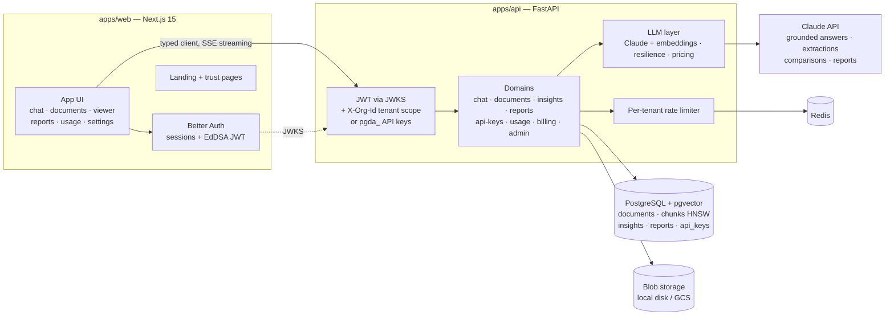

# PG Docs AI

[](https://github.com/pgsofts/pg-docs-ai/actions/workflows/ci.yml)
[](LICENSE)

**AI document intelligence with citations you can verify** — a production-ready,
multi-tenant SaaS workspace where teams upload contracts, proposals, policies and
research, and get Claude-powered answers, summaries, structured extractions,
side-by-side comparisons and exportable reports. Every claim links back to the
page and source chunk it came from.

Built with **Next.js 15 · FastAPI · PostgreSQL + pgvector · Anthropic Claude**.

Homepage: <https://pgsofts.org>

## What it does

| Capability | What you get |
|---|---|
| **Grounded chat** | Agentic Claude loop that searches your documents *before* answering and cites what it used — including saying "not in your documents". |
| **Executive summaries** | One-click summary, key-points list, or risk register (severity table with page references) for any document. |
| **Extraction templates** | Built-ins (payment terms, parties & dates, key obligations, risk register) or your own field specs → structured JSON with per-field source markers. |
| **Document comparison** | Pick 2–5 documents → comparison table, key differences, recommendation — each claim cited on both sides. |
| **Report builder** | Describe the report, choose sources, get Markdown with a full numbered source list; export in one click. |
| **Document viewer** | See exactly what the model sees: every indexed chunk with page numbers, plus insight history. |
| **Usage dashboard** | Tokens, cost (USD), latency and status per feature and model — recorded even for failed or interrupted calls. |
| **Team management** | Workspaces with owner/admin/member roles, email invitations, per-workspace AI provider keys (Fernet-encrypted, write-only). |
| **Workspace API keys** | `pgda_…` keys (SHA-256-hashed at rest, shown once) drive the same REST API from your own systems. |
| **Admin area** | Cross-tenant platform stats and per-org rate-limit overrides, gated by an email allowlist. |

## Architecture



- **Tenant isolation is structural.** Every workspace-owned table carries an
  indexed `tenant_id`, and all access flows through a repository base class that
  injects the filter at query construction. Cross-tenant access has dedicated
  tests (404, never 403).
- **RAG pipeline**: async ingestion (parse → chunk *with page numbers* → embed →
  pgvector HNSW) with hybrid retrieval (vector + lexical fusion) and numbered
  source lists that make fabricated citations structurally hard.
- **API keys**: workspace keys hash-lookup in the auth layer, bind to their org
  (a forged `X-Org-Id` is ignored), and are revocable instantly.

More detail: [RAG architecture](docs/rag-architecture.md) ·
[Claude prompt architecture](docs/claude-prompt-architecture.md) ·
[auth flow](docs/auth-flow.md).

## Quickstart

**Prerequisites**: Node ≥ 22, pnpm (`corepack enable pnpm`), Python 3.12 with
[uv](https://docs.astral.sh/uv/), and Docker (or any PostgreSQL 16 + pgvector and
Redis 7 you can point at).

```bash
git clone <your-fork> && cd pg-docs-ai
make setup    # deps + local .env files
make migrate  # database schema
make dev      # postgres+redis (docker), API on :8000, web on :3000
make worker   # second terminal — document ingestion (ARQ)
```

Sign up at http://localhost:3000, then configure AI:

- paste an **Anthropic API key** (and an embeddings key — Voyage AI works well
  with Claude) in *Settings → AI Provider*, **or**
- set `ANTHROPIC_API_KEY` / `VOYAGE_API_KEY` in `apps/api/.env` as the
  server-wide fallback.

### Seed the demo workspace

```bash
cd apps/api && uv run python scripts/seed_demo.py --email you@example.com
```

Creates (or reuses) a **Demo Workspace** with five realistic multi-page PDFs —
two business proposals, a SaaS agreement, a company policy and a market research
report — and prints suggested demo workflows:

- *Summarize this contract* — open the SaaS agreement → **Summary**
- *Compare these two proposals* — select both proposals → **Compare**
- *List payment terms* — run the **Payment terms** extraction template
- *What risks are mentioned?* — run **Risks** on any proposal

Without an embeddings key the seeder falls back to offline hash embeddings (the
workspace is fully browsable; re-run the seeder with a key for semantic search).

## Environment variables

`apps/api/.env.example` documents everything; the short list:

| Variable | Where | Purpose |
|---|---|---|
| `DATABASE_URL` | api + web | PostgreSQL (asyncpg for the API) |
| `REDIS_URL` | api | rate limiting + local job queue |
| `BETTER_AUTH_SECRET` / `BETTER_AUTH_URL` | web | session signing |
| `AUTH_JWKS_URL` | api | the web app's JWKS endpoint |
| `SECRET_ENCRYPTION_KEY` | api | Fernet key for org provider keys |
| `ANTHROPIC_API_KEY`, `VOYAGE_API_KEY`, … | api | optional server-wide fallback |
| `BILLING_ENABLED`, `STRIPE_*` | api | optional Stripe module (off by default) |

## Testing, linting, evals

```bash
make test          # web + api (pytest, transactional fixtures, fake LLM)
make lint          # ruff + mypy (api), eslint + tsc (web)
make evals         # real-pipeline RAG evals with an LLM judge (~7 min, needs keys)
make generate-client  # regenerate the typed TS client after API changes
```

The eval harness ingests a fixture corpus with real embeddings, runs the real
agent loop, and grades faithfulness and citation correctness — including negative
cases where the right answer is "not in the documents".

## Deployment

The included Terraform deploys the whole stack inside free tiers
(Cloud Run scale-to-zero, Cloud Tasks push jobs, Neon Postgres, Upstash Redis,
GCS, Vercel), with keyless CI/CD via Workload Identity. Full walkthrough:
[docs/deploy.md](docs/deploy.md) · go-live gate: [docs/production-checklist.md](docs/production-checklist.md).

## Demo video

A 90-second product walkthrough script (upload → processing → cited answer →
summary → report export) is in [docs/demo-video-script.md](docs/demo-video-script.md).

## Project structure

```
apps/
├── web/            # Next.js 15 — Better Auth, landing + trust pages, app UI
└── api/            # FastAPI — src/core (auth, tenancy), src/llm (providers),
                    #   src/domains (chat, documents, insights, apikeys, usage, …),
                    #   scripts/seed_demo.py + demo_corpus/
docs/               # architecture docs, deployment, video script, checklist
evals/              # RAG eval harness + fixture corpus
infra/terraform/    # free-tier GCP deployment
```

## License

MIT — see [LICENSE](LICENSE).
