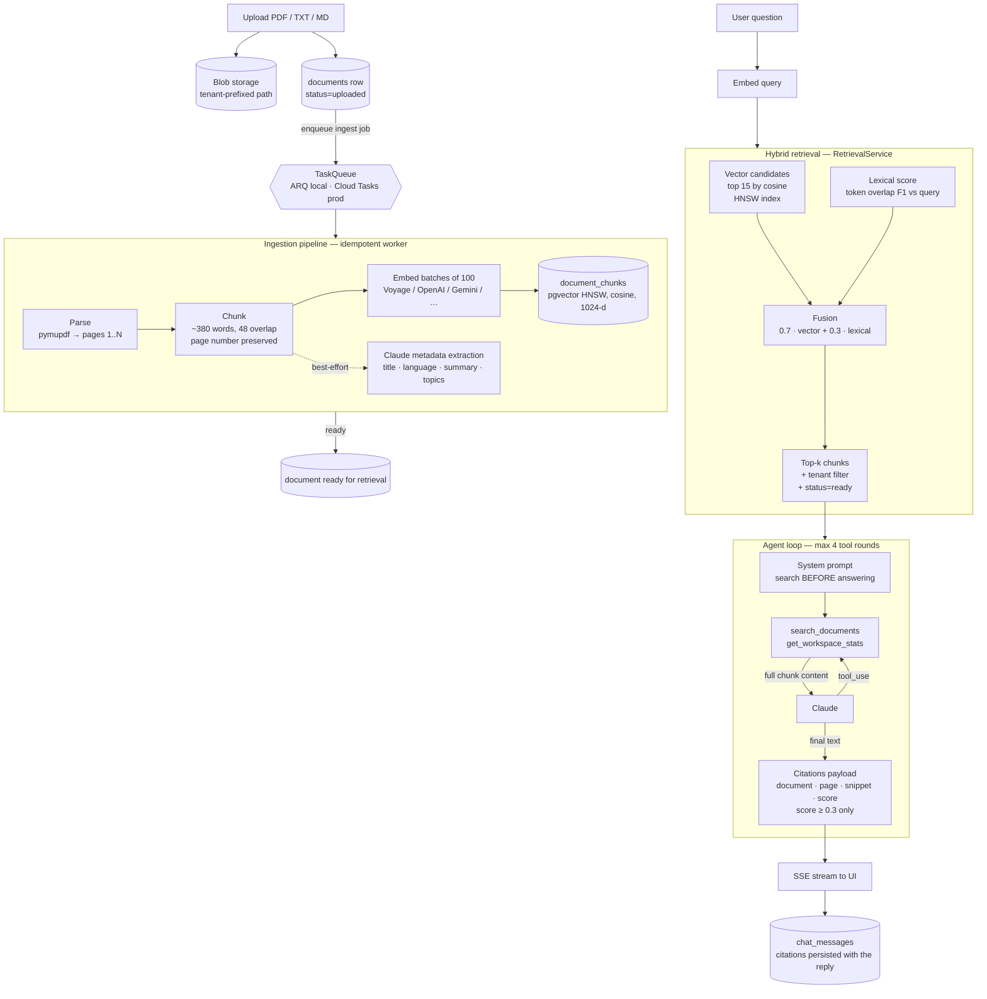

# RAG Architecture

How PG Docs AI turns uploaded documents into grounded, cited answers — and why
fabricated citations are structurally difficult.

## End-to-end diagram

## Component detail

### 1. Ingestion (documents domain)

- **Parse** — PDFs page-by-page via pymupdf (citations carry real page numbers);
  TXT/MD as a single page-less stream.
- **Chunk** — sliding window ≈380 words with 48-word overlap (≈512 tokens);
  tails shorter than 20 words merge into the previous chunk.
- **Embed** — batched (100) through the workspace's configured embedding
  provider; every call is metered to `llm_usage` (`feature=ingestion`).
- **Store** — `document_chunks.embedding vector(1024)` with an HNSW index
  (`m=16, ef_construction=64, cosine`). Changing the embedding model or
  dimension requires a migration and re-ingestion.
- **Metadata** (best-effort) — a structured-output Claude call extracts
  title/language/summary/topics; failure never fails ingestion.
- The job is **idempotent** (re-runs replace chunks) and **retried** (max 3);
  failures set `status=failed` with the reason, surfaced in the UI.

### 2. Retrieval (hybrid, tenant-scoped)

`RetrievalService.search()` runs one query:

1. **Vector**: top-15 candidates by cosine distance over the HNSW index,
   filtered by `tenant_id` and `document.status = ready`. A document-id filter
   narrows to specific documents (used by report generation).
2. **Lexical**: token-overlap F1 between the query and each candidate chunk —
   exact identifiers (section numbers, amounts, product names) survive
   paraphrase-heavy embeddings.
3. **Fusion**: `score = 0.7·cosine + 0.3·lexical`, top-k returned.

Every candidate is billed and logged as an embedding call.

### 3. Grounded answering (chat agent)

The agent loop gives Claude two tools and a hard rule: *call `search_documents`
before answering any factual question*. Retrieved chunks are returned to the
model in **full** (UI snippets are display-only — an early bug sent 400-char
previews and the model claimed information wasn't there; the eval harness caught
it). Citations below cosine 0.3 are context for the model but never surface to
the user. The final reply and its citations are persisted together, so history
stays verifiable.

### 4. Document intelligence artifacts (insights domain)

Summaries, risk registers, extractions, comparisons and reports share one
contract with the agent:

1. **Numbered source list** — selected chunks (document order with a character
   budget; reports use relevance-selected chunks per document) are rendered as
   `[n] Document — page N` blocks.
2. **Grounded generation** — Claude must cite markers inline; the system prompt
   forbids outside knowledge and instructs "not stated" over guessing. Document
   text is delimited as data, blunting injection.
3. **Citation post-processing** — markers are parsed from the output, mapped to
   the source list, and any marker the model invented is dropped. The stored
   artifact carries markdown + structured result + the surviving citations
   (extraction adds per-field `<field>_source` integers via a JSON schema).

### 5. Verification loop

The document viewer shows the identical chunks retrieval sees, so a user can
check any citation against the source in one click. The eval harness
(`make evals`) closes the loop system-wide: real ingestion, real agent, LLM-judge
scoring on faithfulness *and* citation correctness, with negative cases where
the correct answer is "not in the documents".

## Multi-tenancy

Every table in the path (`documents`, `document_chunks`, `chat_messages`,
`document_insights`, `reports`) carries `tenant_id`; repositories inject the
filter at query construction (see `src/core/repository.py`). Vector search,
chunk listing and insight retrieval are all tenant-scoped by the same
mechanism, and dedicated tests attempt cross-tenant reads (expected: 404).

## Operational notes

- **Rate limits** apply per workspace (requests/min, tokens/day, plan-aware)
  before any model call; Redis-backed, fail-open.
- **Usage rows survive failure** — recorded on the error path with output
  estimated from streamed characters.
- **Queue backends** are interchangeable: ARQ on Redis locally, Cloud Tasks
  (OIDC-signed push to `/internal/jobs`) in production — no always-on worker.
